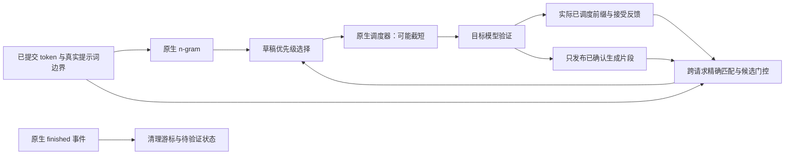

# RecallSpec v2 设计与归属

## 问题

原版只在原生 n-gram 没有草稿时才查跨请求索引。短上下文的本地匹配经常能提出草稿，但不代表草稿会被接受，因而可能挡住更长上下文的共享续写。v2 将“有没有草稿”和“草稿是否值得验证”分开：默认优先尝试 12/8-token 上下文共享匹配，未命中或被反馈门控时回退原生 n-gram。`shared_first=false` 保留原版优先级作为消融。

这是一种工程策略，不是新提出的推测解码算法。较长匹配不能证明语义一致，所有草稿仍经原生目标模型验证。

## 状态与不变量

1. 输入边界来自 worker 的真实 `num_prompt_tokens`，不再通过第一次 sampled 长度猜测。仅 `continuation_start >= prompt_length` 且 `continuation_end <= committed_length` 的完整片段可写入索引。
2. 同一批先查询，后统一更新；不利用该批刚刚提交的其他请求内容制造依赖批内次序的命中。
3. 请求游标按 ID 保存，不按批索引保存；批重排不会串位。暂未调度不等于结束；仅原生 finished 事件删除活跃游标和待验证记录。预占后的已提交历史必须保持单调；异常回滚直接报错。
4. 缓存按精确 token 元组匹配，没有哈希压缩造成的语义碰撞。每键最多两个来源，每次插入即执行 LRU 容量上限。TTL 按写入步计时、按查询惰性清理，访问不能延长陈旧内容寿命。这里的步是 proposer 调用次数，不是墙钟时间。
5. 缓存键数受限不等于精确字节预算；Python 对象有额外内存开销。单请求每次最多索引 32 个新窗口，超额跳过较旧窗口，防止长历史集中维护拖慢整批。该上限会降低召回率。
6. 同步验证中 sampled 为“接受草稿前缀 + 一个目标 token”。反馈必须与本步 `scheduled_spec_decode_tokens` 的实际内容对齐，可接受调度截短；提出但未调度、空输出、取消都不计为拒绝。接受数必须与真实前缀一致，否则失败。
7. 门控只消费经过核验的反馈。每两次观测的平均接受 token 少于 2 则对该候选暂停 32 个 proposer 步，再允许探测。门槛是预设启发式，不宣称是已校准的时间成本最优策略。不同来源候选分别记账；候选替换或 LRU 淘汰后，旧反馈不会影响新的条目。

## 集成方式

vLLM 0.32.0 的 CPU NgramProposer 接口已不携带 request ID。v2 在 GPUModelRunner 的 n-gram 分支增加显式调用点，通过同一 worker 的 req_ids、token buffer、prompt boundary 和 scheduler output 做关联。另一个生命周期调用点位于 worker 状态更新入口。

补丁校验 worker 和 n-gram 源码 SHA-256 及安装版本，可撤销，拒绝未知源码。计时基线恢复原始 worker；源码归属、配置与完整输出随每次运行保存。没有再通过 sitecustomize 隐式覆盖类方法。

本扩展针对 `GPUModelRunnerV1`，通过 `VLLM_USE_V2_MODEL_RUNNER=0` 为四组一致固定。vLLM 0.32.0 在当前环境默认可能启用 V2 runner，它不经过本补丁的调用点。诊断运行若无 worker trace 或共享索引初始化记录会直接失败；此外单列原始默认 V2 的无推测/ngram 外部对照，不能把 V1 组内的比值写成相对默认配置的普遍加速。

## 复用与自写

自写：有界索引、提交游标、精确反馈关联、候选冷却与重新探测、worker 扩展点、实验/对照/统计工具。

复用：模型 forward、Attention/KV Cache、原生 n-gram 查找、草稿调度与批量验证、rejection sampler、输出采样、CUDA Graph 和编译器。没有重写 CUDA/Triton 算子，不能以此项目声称算子开发能力。

## 限制

单引擎、单租户、单 GPU、同步、完整注意力文本模型；不支持多模态、LoRA、跨进程/跨模型缓存、生产多租户路由。缓存只能在同一隔离引擎复用，不能把任意客户端 tenant 字符串当作可信隔离身份。本项目不提供在线服务的授权与隔离能力。

算法验证与 BF16 数值稳定性是不同的问题。严格 token 对照与普通模式性能分别运行；原生推测模式也必须作为正确性负对照。不以请求 logprobs 强行获得一致性，不隐去首次分歧。

## 实验协议

原生无推测、原生 n-gram、共享无门控、共享有门控四组。每种子一个新引擎，模式顺序按种子预定轮换；无诊断计时与有诊断机制运行分开。共同解码长度、模型、BF16、同步调度、Attention 后端、上下文上限及前缀缓存开关。

主负载包含整数序列重复续写、普通技术问答、后缀相同但前部指令不同的冲突任务；都通过模型 chat template 渲染。它们是可控合成工作负载，不代表业务对话分布。种子改变请求标识与冲突任务内容，不等于多份真实数据集。

每种负载依次 batch 1/8；batch 8 继承同进程 batch 1 的缓存。每组首轮单列，后续轮统计中位数。初次编译与无关预热不计入运行耗时；任务的首轮仍保留，不能将其隐去后声称从冷启动开始加速。离线 `generate` 批耗时不等于在线 TTFT/TPOT。

“general” 是 12 个固定技术主题的轮换，加上变化的 case ID，不是一批从未重复的真实问题；batch 8 中可能重遇先前主题并复用输出。冲突任务也包含重复的倍数参数，不能解释为完全无复用负对照。结论只对应这些公开、可重放的输入；普通线上流量仍需独立轨迹评估。
